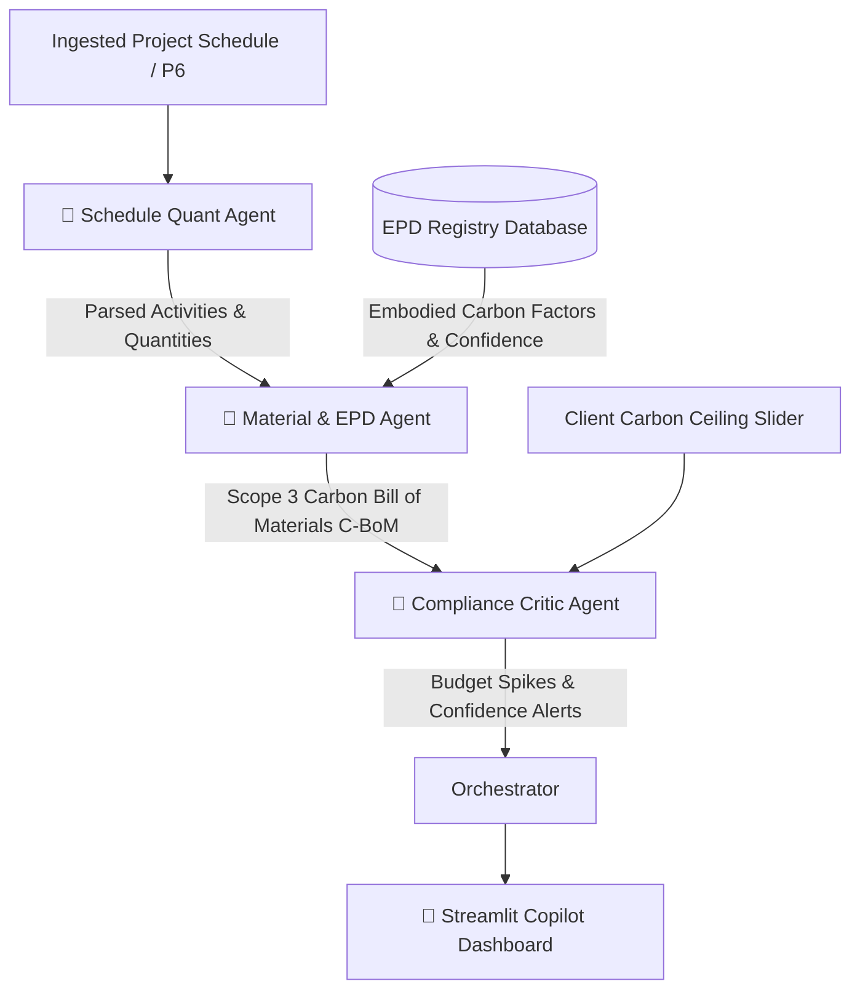

# 🌱 ESG & Sustainability Copilot

> **Autonomous Multi-Agent System for Predicting Scope 3 Embodied Carbon in Construction Schedules**

[](https://www.python.org/)
[](https://streamlit.io/)
[](https://plotly.com/)
[](LICENSE)

---

## 📌 Executive Summary

Large infrastructure and capital construction projects routinely face stringent carbon budget caps alongside traditional schedule and cost constraints. Embodied carbon (Scope 3) accounts for the vast majority of built environment emissions, yet carbon assessments are traditionally performed as disconnected, static post-mortems.

The **ESG Copilot** bridges the gap between schedule forecasting and environmental impact. By orchestrating specialist AI agents, this platform ingests construction schedules (such as Primavera P6 work breakdown structures), maps structural materials against verified Environmental Product Declaration (EPD) databases, calculates time-phased carbon emissions, and proactively audits carbon spikes against client compliance ceilings.

---

## 🏛️ Multi-Agent Architecture

The copilot operates via a sequential multi-agent orchestration pattern:



### 1. 🤖 Schedule Quant Agent
* **Role:** Parses construction schedule items into structured timelines and standardized units.
* **Outputs:** Activity ID, task description, timeline phasing (`Month 1`, `Month 2`, etc.), material specifications, and volumetric/mass quantities.

### 2. 🤖 Material & EPD Agent
* **Role:** Matches construction materials (concrete grades, structural steel, pre-cast elements) against verified Environmental Product Declarations (EPDs).
* **EPD Benchmarks Used:**
  * National ICE (Inventory of Carbon & Energy) Database
  * Verified Supplier EPDs (e.g., Cemex)
  * CARES UK Recycled Steel Standards
  * Regional benchmark proxies for unverified materials
* **Calculations:** Evaluates Global Warming Potential (GWP):
  $$\text{Embodied Carbon }(t\text{ CO}_2e) = \frac{\text{Quantity} \times \text{GWP factor}}{1000}$$
* **Confidence Scoring:** Assigns confidence scores (0.0 – 1.0) based on source verification quality.

### 3. 🤖 Compliance Critic Agent
* **Role:** Acts as an autonomous environmental compliance auditor.
* **Audit Checks:**
  * **Budget Spikes:** Aggregates emissions monthly and raises high-severity guardrail alerts when monthly ceilings are exceeded.
  * **Low Confidence Matches:** Detects fallback proxies (<80% match confidence) requiring human-in-the-loop engineering sign-off.

---

## 🚀 Key Features

* **Multi-Project Scheduling Simulation:** Test against diverse civil infrastructure profiles:
  * *High-Speed Rail Viaduct - Phase 2* (Deep piling, viaduct piers, steel decks)
  * *Urban Hospital Tower* (Heavy substructure, core walls, composite framing)
  * *Highway Interchange* (Retaining walls, bridge abutments, emergency deck repair)
* **Real-Time Deliberative Feed:** Live visualization of agent communications and orchestrator status using native expandable execution streams.
* **Executive Metrics Strip:** Instant visibility into Total Embodied Carbon ($t\text{ CO}_2e$), the Carbon-Critical Month, and Active Compliance Alerts.
* **Interactive Scope 3 Burn Curve:** Plotly-powered monthly emissions curve overlaid with dynamic client carbon budget threshold lines.
* **Detailed Carbon Bill of Materials (C-BoM):** Comprehensive data ledger table displaying per-activity emissions, EPD sources, and confidence metrics.

---

## 🛠️ Tech Stack

| Layer | Technologies |
|---|---|
| **Language** | Python 3.11 / 3.14 |
| **Frontend & UI** | Streamlit |
| **Data Analytics** | Pandas, NumPy |
| **Data Visualization** | Plotly Express |
| **Environment Management** | python-dotenv |
| **AI / GenAI Extensions** | google-genai, Google Gemini API |

---

## 📦 Installation & Setup

### 1. Clone Repository
```bash
git clone https://github.com/garimakamra-spec/nplan-carbon-agent.git
cd nplan-carbon-agent
```

### 2. Configure Environment Variables
Copy `.env.example` to `.env`:
```bash
copy .env.example .env
```
Populate your `.env` file with your Gemini API key (if using GenAI extensions):
```env
GEMINI_API_KEY=your_gemini_api_key_here
```

### 3. Install Dependencies
```bash
py -m pip install -r requirements.txt
```
*(Or `pip install -r requirements.txt` if python is in your PATH)*

---

## 🖥️ Running the Application

Launch the Streamlit web dashboard:

```powershell
py -m streamlit run app.py
```

Once started, open your browser at **`http://localhost:8501`**.

---

## 📂 Project Structure

```
nplan-carbon-agent/
├── .env                  # Environment secrets (ignored by git)
├── .env.example          # Sample environment variables template
├── .gitignore            # Git exclusion rules (safeguards .env & caches)
├── agents.py             # Specialist agent functions, EPD database & orchestrator
├── app.py                # Streamlit UI dashboard and interactive visualizations
├── requirements.txt      # Project dependencies
└── README.md             # Project documentation & architecture overview
```

---

## 📈 Roadmap

- [ ] **P6 XML / XER Schedule Ingestion:** Direct parser for Oracle Primavera P6 export files.
- [ ] **LLM Mitigation Agent:** Gemini-driven generative agent proposing low-carbon material substitutions (e.g., GGBS slag concrete, recycled EAF steel) when budget spikes occur.
- [ ] **Automated PDF Audit Reports:** One-click compliance report generation for ESG auditors and project directors.

---

## 👤 Author & Acknowledgments

* **Developer:** Garima Kamra ([@garimakamra-spec](https://github.com/garimakamra-spec))
* **Inspiration:** Developed for autonomous ESG intelligence and carbon risk mitigation across infrastructure schedules.
